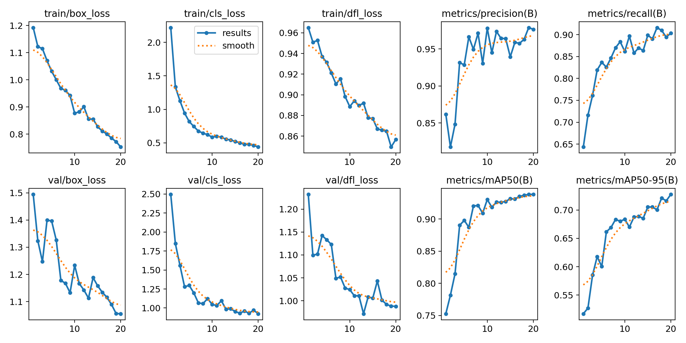
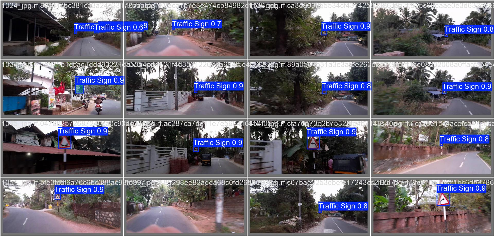

# Autonomous Vehicle Vision System using YOLOv8

Object detection system for autonomous vehicle scenarios, built with YOLOv8.

## Tech Stack
Python, YOLOv8 (Ultralytics), OpenCV, Pandas

## Project Structure
- `EDA.py` : exploratory data analysis
- `scripts/train.py` : model training
- `scripts/detect.py` : run detection

## Dataset
Dataset is not included due to size.
Place it in the `data/` folder before running.

## Setup
pip install -r requirements.txt

## Usage
python scripts/train.py
python scripts/detect.py

## Results
Trained for 20 epochs. Final validation metrics:

| Metric | Value |
|---|---|
| Precision | 0.977 |
| Recall | 0.903 |
| mAP@50 | 0.938 |
| mAP@50-95 | 0.728 |

